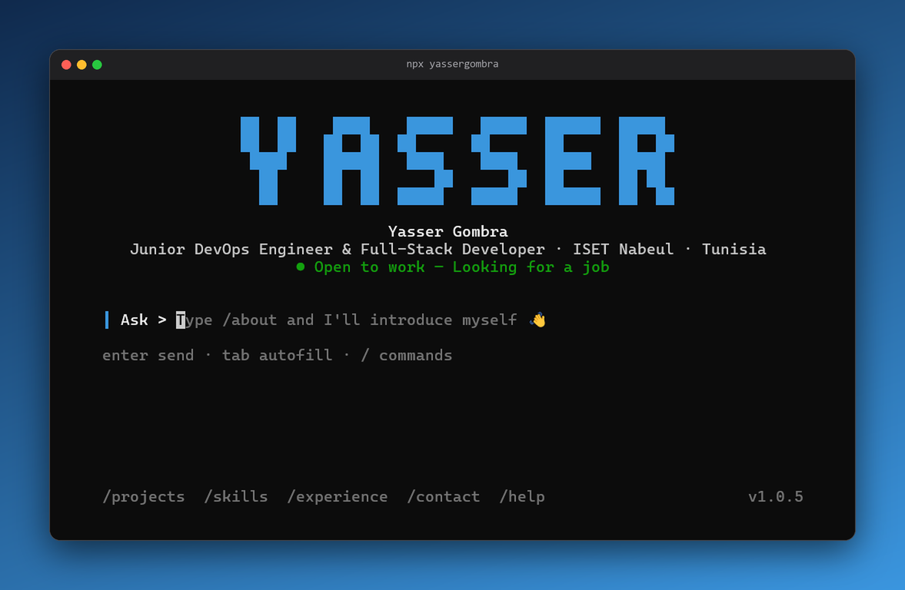

<div align="center">

# yassergombra

**My CV, in your terminal. Ask it anything — it answers as me.**

[](https://www.npmjs.com/package/yassergombra)
[](https://www.npmjs.com/package/yassergombra)
[](https://github.com/YasserYG8/MySeve-CLI/actions/workflows/ci.yml)
[](https://nodejs.org)
[](LICENSE)



```bash
npx yassergombra
```

No install, no sign-up. You only need Node.js 18 or newer.

</div>

---

## What you can do

- **Chat with me.** Ask about my projects, my stack or my experience. The AI answers in the first person, as me, and streams the reply live.
- **`/about`** — I introduce myself: who I am, what I study, what I love building, and what I'm looking for.
- **`/hire`** — Send me a job offer straight from the terminal. Answer in your own words ("hi, I'm Sarah from Acme, sarah@acme.com"); the AI fills the form, shows you a preview, and the message lands in my inbox.
- **Browse my CV** — projects, skills, experience and contact, each on its own screen.
- **Works in any terminal.** The layout adapts to the window size, and the colors follow your terminal theme, light or dark.

## Commands

| Command | What it does |
|---|---|
| `/about` | I introduce myself (AI) |
| `/hire` | Send me a job offer by email |
| `/projects` | My projects, with stack and links |
| `/skills` | My skills, grouped by domain |
| `/experience` | Internships and education |
| `/contact` | Email, GitHub, LinkedIn and more |
| `/help` | All commands and keys |
| `/clear` | Clear the chat |

## Keys

| In the chat | |
|---|---|
| `Enter` | Send |
| `Tab` | Fill in the suggestion, or complete a command |
| `/` | Open the command menu |
| `↑` `↓` | Scroll the chat, or choose a command |
| `Esc` | Stop an answer, or clear your text |
| `Ctrl+C` | Quit |

On the other screens: `P` `S` `E` `C` `H` open Projects, Skills, Experience, Contact and Help, `Esc` or `I` goes back to the chat, and `Q` quits.

## How it works

```
 your terminal                         Vercel Edge                OpenRouter
┌──────────────────────┐   POST    ┌──────────────────┐        ┌──────────────┐
│ npx yassergombra     │ ────────▶ │ proxy/api/chat   │ ─────▶ │ free LLM     │
│ Ink + React + TS     │ ◀──────── │ holds the API key│ ◀───── │              │
└──────────────────────┘  text     └──────────────────┘  SSE   └──────────────┘
           │
           │ /hire
           ▼
     FormSubmit ──▶ my inbox
```

- The CLI is built with **[Ink](https://github.com/vadimdemedes/ink)** (React for the terminal) and **TypeScript**.
- The AI runs on free models through **[OpenRouter](https://openrouter.ai)**. A small **Vercel Edge** proxy keeps the API key on the server, so the npm package has no secrets.
- `/hire` sends the message with **[FormSubmit](https://formsubmit.co)**, so it needs no backend of its own.
- Every screen counts its own rows and wraps text in code, so the app never gets taller than your terminal.
- New versions are published to npm by **GitHub Actions** with npm trusted publishing, with no npm token stored anywhere.

## Run it locally

```bash
git clone https://github.com/YasserYG8/MySeve-CLI.git
cd MySeve-CLI
npm install
npm run build
node dist/index.js
```

To run from source with auto-restart on save, use `npm run dev`. It needs [Bun](https://bun.sh).

By default, the chat goes through the public proxy. To call OpenRouter directly, create a `.env` file with your own key:

```bash
cp .env.example .env   # then set OPENROUTER_API_KEY
```

## Release

Publishing runs on GitHub Actions (`.github/workflows/publish.yml`) when a version tag is pushed:

```bash
npm version patch        # or minor / major: bumps package.json and creates a vX.Y.Z tag
git push --follow-tags   # the tag starts the publish workflow
```

The workflow uses npm trusted publishing, so no npm token is stored in GitHub. One-time setup on npmjs.com: package **Settings → Trusted Publisher → GitHub Actions**, with owner `YasserYG8`, repository `MySeve-CLI` and workflow file `publish.yml`.

To publish by hand instead, run `npm login` and then `npm publish` (it builds first through `prepublishOnly`).

## Deploy the proxy (Vercel)

The proxy is in `proxy/` and runs on the Vercel Edge Runtime.

```bash
cd proxy
vercel login
vercel env add OPENROUTER_API_KEY   # apply it to Production
vercel --prod
```

The proxy then runs at `https://<your-project>.vercel.app/api/chat`. Set `CHAT_PROXY_URL` to use your own proxy.

## Let's talk

I'm **Yasser Gombra**, a Junior DevOps Engineer and Full-Stack Developer from Tunisia, and I'm open to work.

[yassergombra.com](https://yassergombra.com) · [LinkedIn](https://linkedin.com/in/gombra-yasser-a8ab46274) · [GitHub](https://github.com/YasserYG8) · [X](https://x.com/YasserGombra) · [yasserg4e@gmail.com](mailto:yasserg4e@gmail.com)

Or just run `npx yassergombra` and type `/hire`. 🚀

## License

[MIT](LICENSE) © Yasser Gombra
